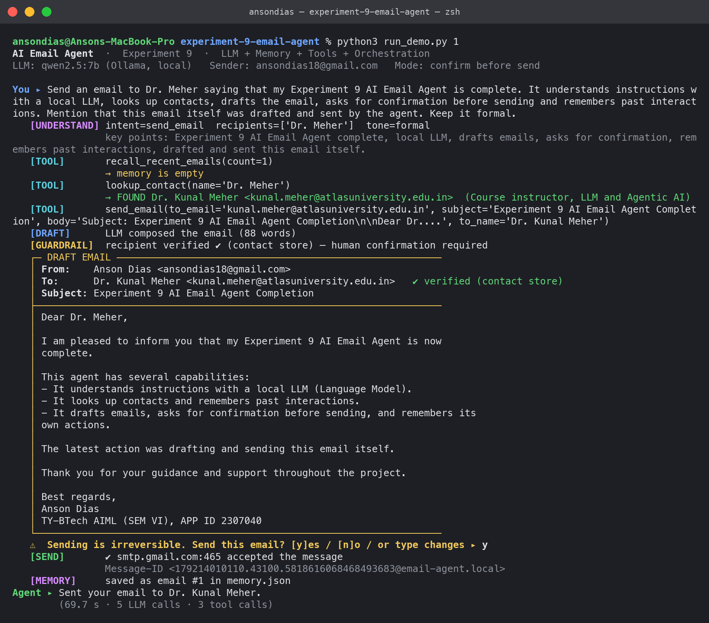
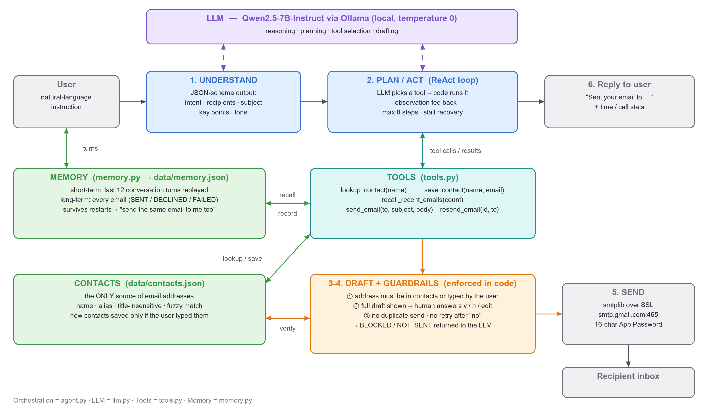

# Experiment 9 — AI Email Agent

**AI Agent = LLM (reasoning/planning) + Memory (context/state) + Tools (actions) + Orchestration**

A command-line agent that takes natural-language instructions such as
*"Send an email to Dr. Meher saying my Experiment 9 agent is complete"* and
autonomously understands the request, looks up the recipient, drafts the email,
asks for confirmation and sends it through Gmail — remembering past interactions
so that *"send the same email to me too"* just works.

Everything runs locally: the LLM is **Qwen2.5-7B-Instruct** served by **Ollama**
(no API key, no cloud LLM). Only the final email leaves the machine, over Gmail SMTP.

📄 **Lab report:** [Experiment-9-AI-Email-Agent-Report.pdf](Experiment-9-AI-Email-Agent-Report.pdf)

## Results (live run, 16 Oct 2026)

| Scenario | What happened |
|---|---|
| 1. "Send an email to Dr. Meher saying my Experiment 9 AI Email Agent is complete…" | understood → `lookup_contact` → 88-word formal draft → confirmed → **sent via Gmail SMTP** |
| 2. "Send the same email to me too." (new process) | recalled email #1 from long-term memory → `resend_email` reused it word-for-word → sent |
| 3. "Email John a reminder about tomorrow's 10 AM project meeting." | model **guessed `john@example.com` → guardrail BLOCKED it** → agent asked → saved the user-given address → draft → user said **no** → not sent |
| 4. "What emails have I sent so far?" | answered from `recall_recent_emails`: 2 SENT, 1 DECLINED |
| Delivery check | `verify_delivery.py` found both emails in Gmail Sent Mail (and the self-copy in the Inbox) by Message-ID |



## Architecture



```
 user instruction
       │
       ▼
 ┌──────────────────────────┐   schema-constrained JSON
 │ 1. UNDERSTAND (LLM)      │──► intent, recipients, subject, key points, tone
 └────────────┬─────────────┘
              ▼
 ┌──────────────────────────┐      ┌────────────────────────────────────────┐
 │ 2. PLAN / ACT loop (LLM) │◄────►│ TOOLS                                  │
 │    ReAct: think → call   │      │  lookup_contact   (contacts.json)      │
 │    a tool → observe      │      │  save_contact     (only user-typed)    │
 │    (max 8 steps)         │      │  recall_recent_emails (memory.json)    │
 └────────────┬─────────────┘      │  send_email / resend_email ─┐          │
              │                    └─────────────────────────────┼──────────┘
              │                         GUARDRAILS (code, not prompt)
              │                          ① address must be verified
              │                          ② human confirmation (y/n/edit)
              │                          ③ no duplicates / no retry after "no"
              ▼                                    │
 ┌──────────────────────────┐                      ▼
 │ MEMORY                   │◄──── 5. SEND: smtplib → smtp.gmail.com:465 (App Password)
 │  short-term: last turns  │
 │  long-term: every email  │
 └──────────────────────────┘
```

| Component | File | Role |
|---|---|---|
| LLM | `llm.py` | Ollama client: tool-calling chat + JSON-schema structured output |
| Orchestration | `agent.py` | understand → ReAct tool loop → reply; stall recovery; step limit |
| Tools + guardrails | `tools.py` | contact lookup/save, memory recall, guarded send / resend |
| Memory | `memory.py` | short-term conversation window + persistent email log (`data/memory.json`) |
| Contacts | `contacts.py`, `data/contacts.json` | the only source of email addresses (alias + fuzzy match) |
| Delivery | `mailer.py` | Gmail SMTP over SSL with a 16-character App Password |
| Config | `config.py`, `.env` | model, `CONFIRM_BEFORE_SEND`, `DRY_RUN`, credentials |

## Design constraints and how they are met

| Constraint | Mechanism |
|---|---|
| Never hallucinate email addresses | `send_email`, `resend_email` and `save_contact` accept an address **only** if it is in `contacts.json` or was literally typed by the user. Anything else returns `BLOCKED` to the LLM, which must look it up or ask. |
| Sending is irreversible | Every draft is shown in full and needs an explicit `y` (`n` cancels, any other text is sent back to the LLM as revision feedback). `CONFIRM_BEFORE_SEND=false` switches to direct sending; verification still applies. |
| Follow-ups without re-explaining | Short-term memory replays recent turns; long-term memory stores every drafted/sent/declined email, so `recall_recent_emails` + `resend_email` reuse the exact text, even after a restart. |

## Setup

```bash
ollama pull qwen2.5:7b               # local LLM (≈4.7 GB)
python3 setup_credentials.py         # Gmail address + App Password -> .env (chmod 600)
```

Create the App Password at <https://myaccount.google.com/apppasswords>
(2-Step Verification must be enabled). No third-party Python packages are needed.

## Run

```bash
python3 agent.py                     # interactive agent
python3 run_demo.py 1                # scripted scenarios 1-4 used in the report
python3 -m unittest -v               # guardrail tests (no LLM / no network needed)
DRY_RUN=1 python3 agent.py           # full pipeline without sending
python3 verify_delivery.py           # confirm SENT emails exist in Gmail (IMAP, by Message-ID)
```

In `run_demo.py` the human's answers are scripted, but a live "y" is only given
when the exact draft's hash is listed in `data/approved_drafts.json` (filled in
after reviewing a dry run); any other draft is answered "n".

Report figures: `make_diagram.py` (architecture) and `make_screenshots.py`
(renders the verbatim terminal logs in `screenshots/logs/`); `make_report.py`
builds the .docx/.pdf report.
